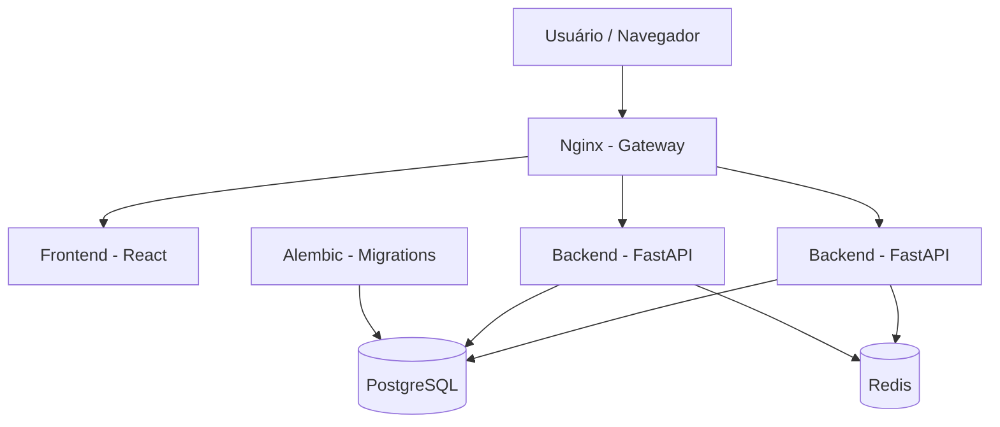

# DuoFlute 🎵

**DuoFlute** é uma plataforma web de aprendizagem de flauta doce soprano em dó, inspirada em aplicativos de aprendizagem gamificada, como o Duolingo.

O projeto está sendo desenvolvido como trabalho acadêmico da disciplina de **Sistemas Distribuídos**, com o objetivo de aplicar conceitos de arquitetura distribuída, conteinerização, comunicação entre serviços, escalabilidade, balanceamento de carga e armazenamento compartilhado.

> **Status:** Projeto em desenvolvimento. Esta versão disponibiliza as funcionalidades já implementadas para demonstração e avaliação acadêmica.

---

## 1. Objetivos do projeto

O DuoFlute busca oferecer um ambiente interativo para auxiliar iniciantes no aprendizado da flauta doce, utilizando uma trilha progressiva de conteúdos, exercícios e recursos de gamificação.

Além da proposta educacional, o projeto permite aplicar conceitos estudados na disciplina de Sistemas Distribuídos por meio de uma arquitetura composta por múltiplos serviços independentes, executados em containers Docker.

## 2. Funcionalidades implementadas

Entre as funcionalidades já desenvolvidas estão:

- Cadastro e autenticação de usuários.
- Autenticação baseada em JWT.
- Armazenamento seguro de senhas utilizando hash.
- Trilha de aprendizagem organizada em seções, unidades e lições.
- Exercícios de reconhecimento e prática musical.
- Reprodução de notas musicais utilizando recursos de áudio do navegador.
- Representação visual da digitação das notas na flauta doce.
- Registro de progresso das lições.
- Sistema de XP, níveis, ofensivas e metas diárias.
- Desbloqueio progressivo de lições.
- Ranking semanal de alunos.
- Cache de conteúdo utilizando Redis.
- Limitação de tentativas de login.
- Verificação de saúde dos serviços.

O projeto continua em desenvolvimento e novas funcionalidades poderão ser incorporadas posteriormente.

## 3. Arquitetura do sistema

O sistema utiliza uma arquitetura baseada em containers, organizados e executados por meio do Docker Compose.

### Serviços

| Serviço | Tecnologia | Responsabilidade |
|---|---|---|
| Frontend | React + TypeScript + Vite | Interface da aplicação |
| Backend | Python + FastAPI | API e regras de negócio |
| Banco de dados | PostgreSQL 16 | Armazenamento persistente |
| Cache | Redis 7 | Cache, ranking e controle de tentativas |
| Gateway | Nginx | Proxy reverso e balanceamento de carga |
| Migrations | Alembic | Gerenciamento da estrutura do banco |

### Comunicação entre serviços

O Nginx funciona como ponto único de entrada da aplicação:

- Requisições para `/api/` são encaminhadas ao backend.
- As demais requisições são encaminhadas ao frontend.
- O backend se comunica com PostgreSQL e Redis por meio da rede privada do Docker.

A arquitetura utiliza duas redes:

- `public-net`: comunicação entre gateway, frontend e backend.
- `private-net`: comunicação entre backend, banco de dados e Redis.

O PostgreSQL e o Redis não possuem portas publicadas diretamente no host na configuração principal.

### Diagrama simplificado



## 4. Tecnologias utilizadas

**Frontend**
- React
- TypeScript
- Vite
- Tailwind CSS
- TanStack Query

**Backend**
- Python
- FastAPI
- SQLAlchemy
- Alembic
- PostgreSQL
- Redis
- JWT
- Argon2

**Infraestrutura**
- Docker
- Docker Compose
- Nginx
- WSL 2 (ambiente de desenvolvimento utilizado)

## 5. Pré-requisitos

Para executar o projeto, é necessário possuir:

- Git.
- Docker Desktop com integração ao WSL 2, no Windows, ou Docker Engine no Linux.
- Docker Compose V2.

Não é necessário instalar manualmente Python, Node.js, PostgreSQL ou Redis na máquina, pois os serviços são executados por meio dos containers.

## 6. Instalação e configuração

### 6.1. Clonar o repositório

```bash
git clone https://github.com/Gustoov0/DuoFlute.git
cd DuoFlute
```

### 6.2. Configurar as variáveis de ambiente

Crie o arquivo `.env` a partir do modelo:

```bash
cp .env.example .env
```

Edite o arquivo `.env` e configure as variáveis necessárias:

```env
POSTGRES_USER=duoflute
POSTGRES_PASSWORD=altere_esta_senha
POSTGRES_DB=duoflute

JWT_SECRET=substitua_por_uma_chave_secreta_forte
JWT_EXPIRE_MINUTES=60

TIMEZONE=America/Sao_Paulo
```

Utilize senhas e chaves próprias. Não compartilhe o arquivo `.env` nem envie credenciais reais ao GitHub.

O Docker Compose configura internamente as URLs de conexão do PostgreSQL e Redis para os containers do backend.

## 7. Executando a aplicação

Na raiz do projeto, execute:

```bash
docker compose up --build -d
```

Esse comando constrói as imagens necessárias e inicia os serviços.

O serviço de migrações executa automaticamente:

```bash
alembic upgrade head
```

O backend depende da conclusão das migrações e da disponibilidade do banco de dados e do Redis.

Para verificar os containers:

```bash
docker compose ps
```

Para acompanhar os logs:

```bash
docker compose logs -f
```

Para encerrar a aplicação:

```bash
docker compose down
```

**Importante:** o comando acima preserva os volumes de dados. Evite utilizar `docker compose down -v` quando desejar manter os dados armazenados no PostgreSQL e Redis.

## 8. Acessando o sistema

Após iniciar os containers, os principais endereços são:

| Recurso | Endereço |
|---|---|
| Aplicação web | http://localhost |
| API | http://localhost/api |
| Documentação Swagger | http://localhost/api/docs |
| Saúde do backend | http://localhost/api/health |
| Saúde do banco | http://localhost/api/health/db |
| Saúde do Redis | http://localhost/api/health/cache |

No ambiente de desenvolvimento, o backend também pode ser acessado diretamente pela porta 8000.

## 9. Recursos de Sistemas Distribuídos

O DuoFlute utiliza diferentes mecanismos para demonstrar conceitos importantes da disciplina.

### 9.1. Conteinerização

Os serviços são executados em containers independentes, permitindo organizar, configurar e executar os componentes da aplicação de maneira isolada.

### 9.2. Balanceamento de carga

O Nginx distribui as requisições entre as instâncias do backend.

É possível iniciar três réplicas do backend utilizando:

```bash
docker compose -f docker-compose.yml up --build -d --scale backend=3
```

Após alterar a quantidade de réplicas, reinicie o gateway:

```bash
docker compose -f docker-compose.yml restart gateway
```

### 9.3. Tolerância a falhas

O sistema permite demonstrar a continuidade do atendimento quando uma das réplicas do backend deixa de funcionar.

Exemplo:

```bash
docker stop duoflute-backend-2
```

As requisições poderão continuar sendo atendidas pelas demais instâncias disponíveis.

Para iniciar novamente a réplica:

```bash
docker start duoflute-backend-2
```

O nome do container pode variar conforme a execução.

### 9.4. Redis e compartilhamento de estado

O Redis é utilizado para:

- Ranking semanal de XP.
- Cache de conteúdo.
- Limitação compartilhada de tentativas de login.
- Verificação de saúde do serviço.

O uso de um serviço compartilhado permite que diferentes réplicas do backend utilizem o mesmo estado, evitando que cada instância mantenha contadores e rankings independentes.

### 9.5. Persistência de dados

O PostgreSQL é utilizado como banco de dados principal.

Volumes Docker garantem a persistência dos dados mesmo quando os containers são encerrados e recriados, desde que os volumes não sejam removidos.

## 10. Desenvolvimento

O projeto possui um arquivo `docker-compose.override.yml`, carregado automaticamente pelo Docker Compose nas execuções convencionais.

Esse arquivo configura recursos voltados ao desenvolvimento, incluindo:

- Recarga automática do backend com Uvicorn.
- Montagem dos arquivos do backend no container.
- Servidor de desenvolvimento Vite.
- Atualização da interface durante a edição do código.

Para iniciar o ambiente de desenvolvimento:

```bash
docker compose up --build
```

Para executar a configuração principal sem o override:

```bash
docker compose -f docker-compose.yml up --build -d
```

## 11. Estrutura do repositório

```text
duoflute/
├── backend/
│   ├── app/
│   ├── alembic/
│   ├── Dockerfile
│   └── requirements.txt
├── frontend/
│   ├── src/
│   ├── Dockerfile
│   ├── package.json
│   └── vite.config.ts
├── nginx/
│   └── nginx.conf
├── docs/
│   └── duoflute_modelo_banco.mermaid
├── docker-compose.yml
├── docker-compose.override.yml
├── .env.example
├── .gitignore
└── README.md
```

## 12. Estado do projeto

O DuoFlute encontra-se em desenvolvimento. A versão atual implementa a estrutura principal da aplicação, autenticação, conteúdos educacionais, progresso dos usuários e mecanismos de distribuição e compartilhamento de estado.

Novas funcionalidades, melhorias na interface, recursos educacionais e aprimoramentos na infraestrutura poderão ser adicionados durante a continuidade do desenvolvimento.

---

**DuoFlute — Aprenda música, uma nota de cada vez.**